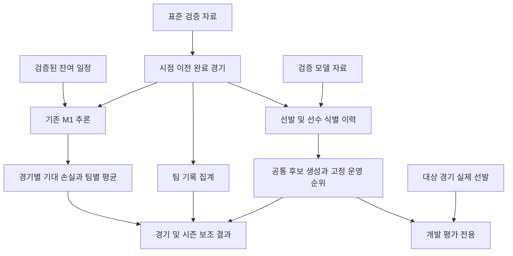

# 예상 선발투수·팀 전력·일정 난이도 실행과 결과 계약

**기존 경기 예측과 시즌 전망을 변경하지 않고 관측 기록과 기존 M1을 활용하는 보조 분석.**

| 항목             | 정의                                                                                                                  |
| ---------------- | --------------------------------------------------------------------------------------------------------------------- |
| 문서 역할        | 기술 계약 및 개발 검증 기록                                                                                           |
| 검토 기준일      | 2026-11-28 KST                                                                                                        |
| 저장소 경로      | `docs/standards/support_analysis.md`                                                                                  |
| 확인한 원격 기준 | `3959da8552a2323cd10159c0f14103b850173648` (v1.1.0)                                                                   |
| 적용 버전        | v1.1.0, `starter-rotation-v2`                                                                                         |
| 관련 작업        | [Issue #29](https://github.com/Ahn-SooHyun/kbo-insight-ai/issues/29)                                                  |
| 상태             | 원격 구현·형식 정리·사용자 계산 검증 확인; 공통 문서 전체본 작성 완료; 실제 적용·최종 Git 검사·하위 수용·PR·병합 대기 |

[공통 계약](project_contract.md) · [M1](game_outcome_score.md) · [정규시즌 전망](regular_season_standings.md) · [포스트시즌 전망](postseason_forecast.md) · [개발 흐름](../planning/development_workflow.md)

[1. 목적·지원 범위](#overview) · [2. 자료·분할·품질](#data) · [3. 입력·전처리](#inputs) · [4. 정답·출력 계약](#outputs) · [5. 모델·학습·선정](#method) · [6. 강의 원리 및 프로젝트 확장](#lecture-methods) · [7. 평가 지표·실제 결과](#evaluation) · [8. 구현·산출물·재현성](#reproducibility) · [9. 검증·한계·후속 연결](#limitations) · [10. 실행 명령](#commands)

<a id="overview"></a>

## 1. 목적·지원 범위

2025년 정규시즌의 KST 날짜 경계에서 팀별 기록, 다음 관측 일정의 경기일 예상 선발 후보, 잔여 일정 난이도를 제공한다. 예측 후보는 공식 선발 발표, 현역 등록 상태, 감독 의도, 건강 상태 또는 선발 확률이 아니다. 기존 M1 및 시즌 시뮬레이션의 입력·가중치·출력·난수 계산을 변경하지 않으며 독립 주 예측기를 추가하지 않는다. 2026년 최종 Test, 원천 재수집, 라인업·교체, 서비스 배포는 제외한다.

### 1.1 문제 정의와 계산의 분류

| 기능                | 문제와 계산 단위                          | 입력                                           | 출력                                   | 신규 학습 |
| ------------------- | ----------------------------------------- | ---------------------------------------------- | -------------------------------------- | --------- |
| 예상 선발           | 예정 경기의 팀 측별 후보 검색·결정적 순위 | 식별이 가능한 이전 선발, 관측 소속·등판·부담   | 최대 3명의 순위 후보와 근거, 제한 상태 | 없음      |
| 팀 전력·최근 경기력 | 구단·기간·장소·상대별 기술통계            | 기준일 전 완료 경기의 점수와 참가 팀           | 승무패·득실점·경기당 지표·분모         | 없음      |
| 잔여 일정 난이도    | 잔여 경기별 기대 손실 및 팀별 집계        | 고정 관측 상태, 유효 일정, 기존 M1 승무패 확률 | 경기·팀별 난이도와 유효 분모           | 없음      |

후보 순위는 선수별 확률 분포를 학습하는 지도 분류기가 아니다. 실제 선발 ID는 규칙 평가용 정답이며 모델 학습용 Target으로 전달하지 않는다. 팀 전력은 예측 점수가 아니라 관측 기록이다. 난이도는 기존 M1의 모델 기반 확률을 변환한 별도의 지표이며 팀 실력의 인과 효과나 공식 순위 예측을 대체하지 않는다.

### 1.2 기능 관계와 책임 경계



실행은 `game`, `season`, `evaluate`로 분리한다. `game`의 M1·후보·난이도는 같은 시나리오의 `season` 결과 중 해당 경기와 일치해야 한다. `evaluate`는 고정 검증판에서 과거 후보 재구성과 정답의 비교를 수행한다. 평가 정답에서 운영 입력으로 이어지는 경로는 없다. 운영 규칙 선정 근거는 명시적인 메타데이터로 고정하며 실행 중 재선정하지 않는다.

<a id="data"></a>

## 2. 자료·분할·품질

표준 검증판 `e020dafedc8b4fd9ac6696d0e4e4a92e:37b56c39caf5435e8fb2a17f993ec4df`, 모델 자료 `259b38decaac4ed68dd5a596cfbe4849`, M1 `0d9433b8044e48e5a4d21bbdb9b432e5`가 인수 대상이다. 기존 `verify_assets`, `read_completed`, `load_scenario`로 자료·모델 계보와 경기 키를 검증한다. 사용자 사전 점검에서 `starter_evidence` 37,810행, `starter_actual` 31,579행, `starter_history` 5,758행, `starter_pre_game` 36,153행이 확인되었다. 전체 판본 행 수이며 2025년 평가 표본 수는 아니다.

후보는 `starter_history`, `player_identity_evidence`, 표준 `player_games`·`player_admission`의 시점 이전 행에서 구성한다. 최종 admission의 이름 충돌 상태를 과거의 입력으로 사용하지 않는다. 이전 경기일 관측 자료만 사용하며, 동명이인/ID 충돌·소속 근거 부재·중복은 별도 처리한다. 과거 `starter_pre_game`은 검증 시 후보와 이전 선발일을 대조하는 자료다. `starter_actual` 대상 경기 행은 정답에만 사용한다. 이전 날짜 결과가 다음 자정에 알려졌다는 기존 가정 및 고정 검증판의 사후 정정 가능성을 보존한다. 당시 공개 시각의 독립 증거는 없다. `evaluate`의 성능 대상은 2025년 정규시즌이며 시즌·팀별 자료 감사는 2026년 1월 1일 미만의 전체 대회 범위다.

### 2.1 입력 테이블과 증거의 역할

| 자료                                       | 역할                                         | 채택 기준 및 주의                                                                                                     |
| ------------------------------------------ | -------------------------------------------- | --------------------------------------------------------------------------------------------------------------------- |
| 표준 `eligible_games`                      | 정규시즌 완료 경기 및 참가 팀·점수·경기 번호 | 기준일 이전, 경기 키 일치, 유효 결과만 사용                                                                           |
| 모델 `starter_evidence`                    | 원천 선발 후보 기록의 감사                   | 이름 및 ID 충돌을 집계; 예정 경기 공식 발표 입력이 아님                                                               |
| 모델 `starter_actual`                      | 실제 선발 정답                               | 경기 측별 이름과 ID·증거 수 확인; 대상일 정답은 평가에만 사용                                                         |
| 모델 `starter_history`                     | 과거 선발 기록                               | ID·이름·증거 수 및 경기·소속·날짜 일치; 대상일 이전만                                                                 |
| 모델 `player_identity_evidence`            | 관측한 이름 및 소속                          | 해당 시즌, 최초 관측일 이전, 실제 경기 참여 팀 일치                                                                   |
| 표준 `player_games`, `player_admission`    | 관측 투구 수와 등판 근거                     | pitcher, preliminary_candidate=1, direct/team mismatches=0, game_state_uncertain=0; 시점 이후 최종 identity 판정 제외 |
| 모델 `starter_pre_game`                    | 기존 후보표 및 이전 선발일 감사              | 과거 평가에만 대조; 예정 경기 후보로 복제하지 않음                                                                    |
| 모델 `m1_index`, `m1_inputs`, `m1_targets` | 기존 완료 경기·분할 및 자산 계보 대조        | 평가의 2025 정규시즌 validation eligible 경기 집합이 완료 경기 집합과 같아야 함                                       |

전체 판본의 식별 가능 선발 이력과 2025년 정답 ID 확보율은 범위가 다른 수치다. 전체 행 수 31,579 대 5,758에서 곧바로 2025년 지원율을 계산하지 않는다. 정답·후보의 키는 `(game_id, team_id)` 및 `(game_id, team_id, player_id)`이며 중복·소속·날짜 불일치가 유효 기록에 들어오면 실패한다. 다른 대회 기록이나 분석 범위 밖 경기는 집계 대상에서 제외한다. 임의 이름 연결이나 수동 정답 보충은 금지한다.

### 2.2 시점 경계와 자료판

기준일을 KST 자정의 날짜 $t$로 두고 경기 날짜 $d$가 $d<t$인 기록만 사용한다. 시즌 창은 해당 연도 1월 1일부터 $t$ 직전까지, 최근 기록 창은 $[t-28,t)$ (시즌 시작 이전은 제외), 투구 부담 창은 $[t-7,t)$이다. 날짜만 있는 같은 날의 기록은 먼저 종료한 경기라도 입력에 포함하지 않는다. 고정 자료판의 정보 경계를 지키는 것은 당시 공개 및 수정 이력을 완전히 입증했다는 뜻이 아니다. `evaluate`의 날짜 창은 2025-01-01 이상 2026-01-01 미만이며 각 경기일을 별도의 cutoff로 사용한다. 평가일의 후보와 실제 선발을 분리하며, 이 비교의 결과는 2025년 개발 선택에 사용하였다. 2026년 자료를 규칙 선택 또는 성능 평가에 사용하지 않았다.

### 2.3 결측·충돌의 해석

| 조건                                                          | 처리                                                        |
| ------------------------------------------------------------- | ----------------------------------------------------------- |
| ID가 없는 실제 선발, 이름이 없는 정답, 증거 부족              | 평가 정답 제외 및 별도 사유 집계                            |
| 후보 이름 충돌, 팀 식별 근거 없음, 마지막 관측 팀 충돌·불일치 | 후보 제외 및 `exclusions`에 집계                            |
| 관측 투구 행 없음                                             | 투구 합계 `null`, `unobserved`                              |
| 관측 행 중 투구 수 결측 또는 확인된 선발의 대응 관측 누락     | `partial_observed`; 알려진 선발 누락 수와 수치 결측 수 분리 |
| 행의 투구 수 0                                                | 실제 기록된 0; 미관측과 동일시하지 않음                     |
| 공식 공개 시각·대상 경기·선발 ID 연결 자료 없음               | 공식 발표 `null`; 예상과 공식 발표를 구분                   |

관측 부담 수치는 남은 유효 행의 제한적인 합계이다. 대응 행이 모두 있는 경우에도 구원 등판의 전수 완전성은 입증되지 않으므로 `observed_rows_only`라고 표현한다. 선수의 최신 관측 소속은 현재 등록 명단·건강·출전 가능 상태가 아니다.

<a id="inputs"></a>

## 3. 입력·전처리

`--project-root`, `--run-id`, `--asset` 및 `game`/`season`의 `--season 2025`, `--as-of YYYY-MM-DD`, 선택 `--schedule-snapshot`, `--parent-run`을 사용한다. `game`은 `--game-id`가 필요하며 `evaluate`는 2025년 개발 비교 전용이다. 날짜·경기 ID·팀 ID는 기존 시즌 계약을 따른다. `--parent-run` 사용 시 선행 실행의 해시, 계보, 기준일, 완료 및 잔여 경기 일치를 검증한다. 모든 시점은 KST 자정이며 대상일 당일 행은 입력에 사용하지 않는다.

### 3.1 실행 인자와 제약

| 인자/하위 명령        | 필수 여부 | 의미                                                 |
| --------------------- | --------- | ---------------------------------------------------- |
| `--project-root`      | 선택      | 명시 프로젝트 루트; 기존 `load_settings` 사용        |
| `--run-id`            | 필수      | 검증 모델 자료 실행 ID                               |
| `--asset`             | 필수      | 검증된 기존 M1 model.json 경로                       |
| `--output`            | 선택      | results 내부 신규 JSON 경로; 기존 파일 덮어쓰기 거부 |
| `game`                | 하위 명령 | `--season 2025`, `--as-of`, `--game-id` 필수         |
| `season`              | 하위 명령 | `--season 2025`, `--as-of` 필수                      |
| `evaluate`            | 하위 명령 | 2025 정규시즌 validation 비교; 시즌/기준일 입력 없음 |
| `--schedule-snapshot` | 선택      | game/season용 기존 시즌 일정 계약; 공개 진위 미인증  |
| `--parent-run`        | 선택      | game/season용 정규시즌 부모 실행 검증                |

기존 시즌 계약이 지원하는 날짜·시즌만 허용한다. 분석 입력은 파일·DB에 대한 읽기 전용 연결을 사용하고 별도 모델 학습이나 원본 변환을 하지 않는다. `--parent-run`이 있으면 부모 산출물·해시·자산 계보·기준일·완료 경기·잔여 경기·일정 근거가 일치해야 한다. 부모 실행의 반복 결과를 이 모듈에서 재학습·재시뮬레이션하지 않는다.

<a id="outputs"></a>

## 4. 정답·출력 계약

`game`, `season`은 `support-analysis-v1` 결과로 동일 경기 식별자와 as-of, 기존 M1 전망, 팀 기록, 선발 후보 및 일정 난이도를 제공한다. `evaluate`는 선발 평가와 자료 감사 결과를 제공한다. 유효 비율의 분모가 0이면 `null`이다. 공식 발표를 입증할 수 있는 자료가 없어 공식 발표 상태를 부여하지 않는다. 실제 0과 관측되지 않은 값을 구분한다. 경기 전망이 없는 경우 집계에서 누락 수를 표시한다. 유효 경기의 M1 자산이나 계산 계약이 손상된 경우에는 전체 실행을 실패로 처리하며 오류를 정상 누락으로 숨기지 않는다.

v1.1.0은 기존 키·CLI를 유지하면서 `starter_selection`으로 운영 규칙과 선정 범위를 표시한다. 후보 출력에는 `workload_missing_known_starts`, `workload_status`를 추가해 확인된 선발 경기 중 대응 투구 관측 행의 누락을 드러낸다. `observed_pitches_last_7d`는 채택 관측 행의 합이며 공식 총투구 수가 아니다. 관측 행이 없거나 관측 행 내 투구 수가 결측이면 `null`을 유지한다. 알려진 선발과 대응 행이 모두 존재하는 경우에도 모든 구원 등판의 완전성은 입증되지 않는다. 팀 승률의 분모 0은 `win_rate_reason`, 득실점률 분모 0은 `run_rate_reason`으로 설명한다.

### 4.1 공통 출력과 계약

| 키                                                                            | 의미                                                                                    |
| ----------------------------------------------------------------------------- | --------------------------------------------------------------------------------------- |
| `schema`, `version`, `scope`, `status`                                        | `support-analysis-v1`, `1.1.0`, game/season/starter_validation, 완료 상태               |
| `season`, `as_of_kst`, `metadata` 또는 `provenance`                           | 시즌과 기준시각, 시나리오·검증 입력 계보; 평가의 경우 split 및 기간                     |
| `starter_selection`                                                           | 운영 규칙 baseline, 2025 validation 선정 근거, 초기 평가 실행 ID, 독립 최종 평가 미완료 |
| `games`, `teams`, `missing_pairs`                                             | 경기 결과 및 구단 기록/일정, 미편성 쌍; game은 선택 경기 1건                            |
| `parent_regular_season`                                                       | 선택 부모 실행 검증 정보 또는 null                                                      |
| `rule_versions`, `new_primary_models`                                         | game/season 계산 규칙 식별자, 신규 주 예측기 0개                                        |
| `comparison`, `by_team`, `candidate_reference_audit`, `data_audit`, `samples` | evaluate의 전체·공통·팀별 비교 및 표본 단위 감사                                        |
| `run_id`, `created_utc`, `source_sha256`                                      | 실행 식별자, 생성 시각 및 보조 분석 5개 모듈의 SHA-256                                  |
| `formal_backtest_supported`, `final_test_used`                                | false; 고정 자료판 개발용 결과와 최종 Test 격리                                         |

정확한 물리 스키마는 각 버전의 소스와 실행 JSON이 기준이다. `game`의 `teams`에는 참가 구단들의 전체 잔여 일정 난이도와 기록이 포함되며 단일 경기 난이도만 의미하지 않는다. `season`은 모든 구단과 유효 잔여 경기의 출력을 제공한다. `games`의 `fixture`, `m1_forecast`, `starters`, `difficulty`는 동일한 경기 ID에서 대응한다.

### 4.2 주요 지원 상태

| 출력      | 상태                                                 | 해석                                                                    |
| --------- | ---------------------------------------------------- | ----------------------------------------------------------------------- |
| 선발      | `estimated`                                          | 후보와 관측 이력 지원 조건 충족; 공식 선발이 아님                       |
| 선발      | `estimated_limited`                                  | 일부 선발 이력·후보 수·식별 제한; `reason` 및 후보 수 확인              |
| 선발      | `unsupported`                                        | 다음 팀 경기일 아님, 최대 전망일 초과 또는 유효 이력 없음; 빈 후보 목록 |
| 팀 기록   | `supported` / `limited_sample` / `no_observations`   | 표본 5경기 이상 / 1~4경기 / 0경기; 표본 수는 품질 보증이 아님           |
| 일정 집계 | `supported_under_assumption`                         | 유효 전망·편성이 가정상 완전                                            |
| 일정 집계 | `partial` / `schedule_missing` / `no_valid_forecast` | 부분 지원 / 기대 잔여 존재하나 편성 없음 / 유효 편성은 있으나 전망 없음 |
| 일정 집계 | `no_remaining_games_under_assumption`                | 가정한 일정 및 미편성 수에서 기대 잔여 0, 난이도 null                   |

공식 발표 상태는 이 자료판에서 `publication_evidence_unavailable`로 표시하며 `official_announcement`는 null이다. 경기별 M1 예측 자산·확률의 무결성 오류는 일반 미지원 상태로 처리하지 않고 실행 실패로 전파한다. `win_rate_reason=no_decided_games`, `run_rate_reason=no_observations`는 각 분모가 0일 때의 별도 사유다.

<a id="method"></a>

## 5. 모델·학습·선정

- 선발 후보: 이전 28일의 식별 가능한 선발 이력에서 해당 팀에 대한 최신 관측 소속과 이름 일치를 검사한다. 기준 규칙은 예상 이전 선발 후 경과일 내림차순, 이전 선발일 오름차순, 선수 ID 오름차순이다. 비교용 제안 규칙은 2일 미만 예상 등판 간격 페널티, 5일 선발 간격과의 거리, 투구 수 결측 여부, 관측 투구 수 오름차순, 최근 선발 횟수 내림차순, 선수 ID 오름차순이다. 2일·5일은 사전 제안값이며 최적값이 아니다. v1.0.0의 운영 출력은 제안 규칙이었으나 v1.1.0에서는 아래 개발 평가에서 두 지표 모두 우세한 기준 규칙을 운영에 채택했다. 두 비교 계산은 그대로 유지하고 2025 Validation은 규칙 선정 자료로 기록한다. 기준일 이후의 등판이 없다는 조건부 간격이다. 더블헤더의 두 선발을 서로 다르게 확정하지 않는다. 관측 일정상 다음 팀 경기일 및 기준일로부터 7일 이내만 후보를 제공한다. 미편성 일정이 있다면 실제 다음 경기라는 보장은 없다.
- 전력: 승률 = W/(W+L), 경기당 득점 = RF/G, 경기당 실점 = RA/G, 경기당 득실점차 = (RF-RA)/G. 시즌 및 최근 28일, 홈·원정, 상대별 집계를 분리한다. 작은 표본은 상태로 표시하며 임의 종합 점수를 만들지 않는다.
- 일정: 기존 M1 `predict` 및 정규시즌 `inputs_for`를 사용한다. 관측 상태는 기준일에 고정되며 대상일의 최근 28일 창에 들어오는 관측 이력만 사용한다. 대상일 이전에 예정된 경기의 미래 결과는 모의·입력하지 않는다. 따라서 동적 시즌 반복별 확률의 평균과 다르다. 팀 관점 난이도는 P(패)+0.5×P(무), 팀 집계는 유효 전망 경기의 동일 가중 평균이다. KBO 공식 승률 산식과 다른 난이도 정의이며 미편성 경기나 누락 전망은 분모에서 제외한다.
- 신규 학습·최적화 없음. 비교 규칙의 파라미터를 추가 탐색하지 않고 2026 최종 Test를 선택에 사용하지 않는다. 현재 전체 주 예측기는 6개로 유지한다.

### 5.1 선발 후보와 순위 결정의 상세 산식

기준일 $t$, 대상 경기일 $d\geq t$, 팀 $j$에서 최근 28일 동안 팀 $j$의 식별된 선발 이력이 있고 이름 및 최신 관측 소속 검사를 통과한 선수의 집합을 $C_j(t)$라 한다. 선수 $i$의 최근 해당 팀 선발일을 $s_i$, 관측된 마지막 등판일을 $a_i$라 두면 기준일 현재 경과일은 각각 $t-s_i$, $t-a_i$이며 대상 경기일의 조건부 간격은 $d-s_i$, $d-a_i$이다. 이후 추가 등판이 없다는 조건을 가진 날짜 차이이며 실제 휴식일 확정값이 아니다.

운영 기준 규칙은 다음 사전식 정렬 키의 오름차순이다.

$$K_B(i)=(-(d-s_i),\ s_i,\ id_i).$$

날짜가 오래된 선수부터 정렬하고 동률은 선수 ID로 결정한다. 제안 규칙은 다음 사전식 키로 순위를 정했다.

$$K_P(i)=(\max(0,2-(d-a_i)),\ |(d-s_i)-5|,\ m_i,\ q_i,\ -n_i,\ id_i).$$

$m_i$는 투구 수 합계 미관측 여부(False 먼저), $q_i$는 관측 투구 합계(미관측이면 정렬용 0을 사용하되 결측 플래그 선행), $n_i$는 이전 28일 선발 횟수다. 두 규칙은 같은 후보 집합을 사용한다. 정렬은 항목별 우선순위이며 가중 선형 점수나 선발 확률이 아니다. 2일과 5일은 최초 고정한 휴리스틱 값이지 학습 계수·최적 파라미터가 아니다. 후보 수는 `min(3, len(C))`이다. 운영 버전에서 2025 validation 결과에 따라 $K_B$를 선택했다. 투구 부담과 등판 간격은 출력 근거로 제공하지만 운영 순위에서 가중치로 사용하지 않는다. 이 차이는 해석 및 후속 평가에 반드시 남긴다.

대상일이 관측된 팀의 다음 경기일과 같고 $0\le d-t\le7$인 경우에만 후보를 제공한다. 더블헤더는 경기 ID를 구분하지만 동일 날짜의 선발 순위는 공동 배정하지 않는다. 실제 중간 등판 및 미편성 경기의 존재를 알 수 없으므로 원거리 경기 후보를 생성하지 않는다.

### 5.2 관측 기록의 통계적 의미

기간 $I$에서 팀의 완료 경기 $G$, 승리 $W$, 패배 $L$, 무승부 $T$, 득점 $RF$, 실점 $RA$를 계산하면 $G=W+L+T$이다.

$$\operatorname{WinRate}=\frac{W}{W+L},\quad RF_G=\frac{RF}{G},\quad RA_G=\frac{RA}{G},\quad RD_G=\frac{RF-RA}{G}.$$

승률에서 무승부를 제외하지만 경기당 득실점은 모든 유효 완료 경기를 분모로 한다. 시즌·최근 28일, 홈·원정, 상대별 분할을 독립 계산하며 전체 경기 수가 장소별 합 및 상대별 합과 일치하는지 검사한다. 표본 5경기 미만은 경험적 지원 경고 기준일 뿐 통계적 유의성의 임계값이 아니다. 예를 들어 5:2 승, 1:4 패, 3:3 무는 3경기, 승률 1/2=0.5, RF=9, RA=9, 경기당 3.0득점·3.0실점이다(합성 검산 예시). 무승부만 있는 경우 승률은 null이지만 경기당 득실점은 계산한다. 상대별 기록은 관측된 성적이며 상대·홈 효과의 인과 계수로 해석하지 않는다.

### 5.3 일정 난이도: 확률을 기대 손실로 변환

기존 M1의 확률 $p_H,p_T,p_A$는 각각 홈 승·무·원정 승이며 유한한 [0,1] 값, 합 1(절대 오차 허용 $10^{-12}$)을 만족해야 한다. 팀 관점에서 $p_W,p_D,p_L$을 대응시킨다. 손실값을 승 0, 무 1/2, 패 1로 정하면 경기 $g$의 난이도는

$$D_{jg}=E[\ell(Y_{jg})]=p_L+\tfrac12 p_D.$$

유효 전망을 가진 팀의 편성 경기 집합 $F_j^*$의 크기가 $V_j$일 때

$$D_j=\frac{\sum_{g\in F_j^*}D_{jg}}{V_j},\quad V_j>0.$$

분모가 0이면 `null`이다. 미편성 경기 수 $U$, 편성 경기 수 $S$, 유효 전망 수 $V$는 분리한다. 기대 잔여 수는 $S+U$, 전망 누락은 $S-V$, 편성 전망 제공률은 $V/S$, 기대 잔여 기준 전망 제공률은 $V/(S+U)$이다. 확인된 공개 일정 수와 미입증 일정 수 역시 별도 출력한다. 홈·원정 양 팀 난이도 합이 1인 것은 같은 확률 분포에서 $p_H+p_A+p_T=1$이기 때문이다. 예를 들어 홈 승 0.6, 무 0.1, 원정 승 0.3이면 홈 난이도 0.35, 원정 0.65(합성 검산 예시)다. 무승부 0.5와 동일 경기 가중치는 설계 선택이며 KBO 승률 계산이 아니다. 난이도가 높을수록 해당 분포의 기대 손실이 크다는 뜻이다. 실제 패배 확률, 순위 상승 확률, 우승 확률로 대체하지 않는다.

관측 팀 상태는 기준일 이전 완료 경기로 고정한다. M1의 최근 28일 변수는 각 대상 경기일의 창을 사용하므로 먼 대상일에서는 기존 관측 이력이 창 밖으로 빠질 수 있다. 중간 미래 경기를 시뮬레이션하여 이 모듈의 입력에 추가하지 않는다. 정규시즌 시뮬레이션의 동적 반복 경로별 평균과 별개의 고정 관측 이력 계산이며, 두 방식의 수치를 같은 종류의 확률로 해석하지 않는다.

<a id="lecture-methods"></a>

## 6. 강의 원리 및 프로젝트 확장

### 6.1 강의에서 확인한 원리의 실제 적용

이번 검토는 실제 강의 전사에서 다음 구간을 다시 열어 확인했다. 전체 강의 영상·슬라이드 및 모든 전사를 전수 대조하지 않았다. 기존 [개발 흐름의 강의 원리 기록](../planning/development_workflow.md#lecture-methods)과 [M1의 상세 원리](game_outcome_score.md#lecture-methods)를 인수하되, 이번 보조 분석의 직접 적용·원리 응용·미실험을 분리한다.

| 확인한 강의 방법·원리                                                                                                        | 적용 유형                           | 실제 구현·근거                                                                                                  | 해석 제한                                                                                                  |
| ---------------------------------------------------------------------------------------------------------------------------- | ----------------------------------- | --------------------------------------------------------------------------------------------------------------- | ---------------------------------------------------------------------------------------------------------- |
| 공정한 평가와 일반화 검증 (`ml_cv,eval-metric_빨강펜_SW중단.txt`, 00:00:44.740–00:01:01.500)                                 | 원리 직접 적용                      | `evaluation.py`: 동일 후보 집합, 동일 2025 정답, 공통 유효 표본 1,429건에서 기준과 제안 규칙의 Top-1·Top-3 비교 | 일반화 성능 보장과 동일하지 않으며 2025년은 선택 자료                                                      |
| 불필요한 모델 복잡도·과적합과 미관측 시험 자료 평가 (같은 전사 00:03:40.310–00:04:19.720)                                    | 원리 응용                           | 복잡한 제안 순위가 기준보다 낮은 결과를 보존하고 운영 규칙을 기준으로 선정; 최종 Test 분리                      | 제안 규칙의 낮은 성능을 과적합으로 증명한 것은 아님; Bias–Variance 분해·학습 곡선 미실행                   |
| 교차 검증의 취지 (같은 전사 00:00:54.460–00:01:01.500 및 00:03:56.090–00:04:19.720)                                          | 시간 의존 문제에 맞게 변형          | 2025 평가의 각 경기일에 대해 과거 기록만 구성하고 같은 대상·정답을 비교. 무작위 분할을 사용하지 않음            | 이번 평가 자체를 K-fold/Stratified K-fold 또는 정식 시간순 Backtesting으로 부르지 않음                     |
| 실제값과 추정값 차이 및 손실 함수 (`LinearRegression_빨강펜-seg1.txt`, 00:11:00.580–00:11:14.480)                            | 손실 개념 응용                      | 적중 여부의 0/1 오류 사건과 경기 결과의 0/0.5/1 손실을 별도로 정의; 기존 M1 확률의 기대 손실 계산               | 선형회귀·MSE 최소화·경사하강을 이 모듈에서 수행한 것이 아님                                                |
| 범주별 확률에 따른 분류 (`LogisticRegression_update(1)_빨강펜.txt`, 00:00:59.440–00:01:07.520)                               | 확률 개념 응용, 기존 모델 추론 인수 | `team_probabilities`, `difficulty_value`: 홈·무·원정 범주 확률의 팀 관점 변환과 기대 손실                       | 로지스틱 회귀 학습·시그모이드·Softmax 보정을 새로 수행하지 않음; M1의 실제 운영 방식은 `profile_histogram` |
| 복원추출 (`ensemble(2)_빨강펜_updated.txt`, 00:00:44.520–00:00:49.240, 00:00:53.860–00:01:01.580, 00:07:52.110–00:08:04.290) | 확인했으나 미적용                   | 동일 입력에 대한 결정적 정렬과 기술통계·확률 변환을 실행; 복원추출 표본이나 개별 트리 없음                      | 반복 실행을 Bootstrap이나 Bagging으로 해석하지 않음                                                        |

공정한 기준 비교의 실제 증거는 후보표 일치, 동일 평가 표본, 분모 별도 공개 및 기준 선택 기록이다. 강의의 평가 취지는 적용하지만 기존 M1과 정규시즌 전망의 학습·시뮬레이션 계산을 이번 기능의 새 실험으로 중복 계상하지 않는다.

### 6.2 강의 외 프로젝트 확장 원리

아래 방법의 **동일한 상세 알고리즘·정의가 확인한 강의 발췌에서 직접 제시된 사실은 확인하지 못했다**. 따라서 프로젝트 문제에 맞게 실제 구현한 확장으로 기록한다. 강의 전체에서 다루지 않았다는 전수 부재 증명은 아니다.

| 확장 원리                       | 이론·적용 이유                                                                     | 구현과 실제 검증                                                                                                 | 한계                                                                   |
| ------------------------------- | ---------------------------------------------------------------------------------- | ---------------------------------------------------------------------------------------------------------------- | ---------------------------------------------------------------------- |
| 후보 검색과 사전식 정렬         | 동일 집합에서 기준을 우선순위별로 비교하고 ID 동률 처리로 결정성을 확보            | `rank_starters`, `baseline_key`, `proposed_key`; 순위·동률·기간 경계 테스트                                      | 확률 모델 아님; 실제 로테이션 최적화 아님                              |
| 날짜 경계와 관측 가능 정보 집합 | 미래 정답과 같은 날 결과가 입력에 유입되지 않도록 고정 판본의 관측 경계를 적용     | `read_starter_data`와 `rank_starters`; 당일/미래 정답·이름·투구·품질 행의 합성 SQLite 변이 테스트                | 실제 당시 공개 시각 및 원본 정정의 독립 증거 부족                      |
| 순위 적중률 Top-k와 Coverage    | 후보 검색의 제공 여부와 정답 적중 여부를 구분하고 선택된 부분 집합의 편향을 드러냄 | `method_metrics`, `compare_samples`; 공통·전체 식별 정답·전체 대상 분모 제공                                     | 일반 분류 Accuracy와 다른 부분 지원 지표; 선발 확률의 calibration 아님 |
| 관측 부담의 누락 분리           | 알려진 선발 경기와 대응 관측 행의 차집합으로 행 미수집과 수치 결측을 구분          | `workload_missing_known_starts`, `workload_status`; 합성 테스트 및 실제 선수 근거 검산                           | 완전한 총투구 수·부상·건강 판단 근거 아님                              |
| 기간·장소·상대별 층화 집계      | 같은 경기 기록을 관점별로 나누어 표본과 분모를 명시하는 기술통계                   | `team_window`, `record_summary`; 실제 10개 구단 시즌/최근 및 장소/상대별 독립 검산                               | Stratified K-fold가 아니며 상대 효과·홈 이점의 인과 추정 아님          |
| 기대 손실과 동일 가중 평균      | 이산 확률 변수의 기대값과 선형성으로 M1 승무패를 난이도 지표로 변환                | `team_probabilities`, `difficulty_value`, `schedule_difficulty`; 실제 경기별 보완 관계 및 분모 검산              | 무승부 손실 0.5는 설계값; 실제 승률·우승 확률 아님                     |
| 미편성·미지원·분모 0 구분       | 지표 산출 범위가 불완전할 때 임의 0을 만들지 않고 유효 관측 집합을 노출            | `schedule_difficulty`, `record_summary`, `starter_report`; 빈 일정·누락·무승부만 있는 표본·중복 테스트           | 현재 가정의 편성 완전성이 실제 공개 일정의 완전성은 아님               |
| 데이터 계보·지문·결정적 재현    | 같은 입력과 코드에서 계산 결과가 불변인지 검증하고 결과의 파일 무결성과 구별       | `verify_assets`, `verify_parent_run`, `source_hashes`, `save_result`; 3쌍 반복 비교와 개행 정리 후 3건 회귀 비교 | SHA-256 일치는 자료의 사실 정확성 또는 성능 검증을 의미하지 않음       |

### 6.3 주요 미적용 방법과 판단

| 방법                                                                   | 상태                        | 이번 작업에서 사용하지 않은 이유                                                                           |
| ---------------------------------------------------------------------- | --------------------------- | ---------------------------------------------------------------------------------------------------------- |
| 초기 제안 순위 규칙                                                    | 실제 비교 실험, 운영 미채택 | 공통 표본에서 Top-1·Top-3가 기준보다 낮음; 성능 악화 결과 보존                                             |
| 단일/다중 선형 회귀, 로지스틱 회귀, KNN, SVM, 결정 트리                | 신규 학습 미실험            | 보조 후보·기술통계·기존 M1 연결의 문제로 한정; 추가 학습 근거와 승인 없음                                  |
| 랜덤 포레스트·Bootstrap·OOB·Bagging·Boosting·Hard/Soft Voting·Stacking | 미실험                      | 신규 독립 예측기 및 학습 비용 불필요; 실제 데이터 경계·평가가 추가로 필요. 기존 M1 확률 변환은 Voting 아님 |
| 무작위 K-fold·Stratified K-fold                                        | 미실행                      | 시간 및 동일 경기 묶음 경계에 맞지 않으며 실제 운영 평가를 대체할 수 없음                                  |
| Grid/Random Search·GPU·학습 곡선·SHAP                                  | 미실험                      | 학습할 신규 모델이나 탐색할 학습 계수가 없음; 순위 비교는 두 고정 규칙만 사용                              |
| 강화학습·군집화                                                        | 미실험                      | 보상 기반 정책 학습 또는 비지도 집단 발견의 문제가 아님                                                    |

### 6.4 강의 및 이론 근거와 과제 적용 범위

- 직접 열람한 원문: `ml_cv,eval-metric_빨강펜_SW중단.txt` 위 두 시각 구간, `LinearRegression_빨강펜-seg1.txt`의 손실 구간, `LogisticRegression_update(1)_빨강펜.txt`의 범주 확률 구간, `ensemble(2)_빨강펜_updated.txt`의 복원추출 구간. 전사 텍스트의 시각 기준이며 영상 전체를 대조하지 않았다.
- 과제 안내 `창문해_TermProject_가이드.pdf` 3쪽은 AI 활용 기록 및 본인 설명 가능성을 요구한다. 4쪽은 데이터 준비, 목표·평가 정의, EDA, Baseline, Feature Engineering, 모델링·성능 비교, 최적화, 결론·한계의 문제 해결 흐름을 제시한다. 이번 기능은 자료 감사·목표 및 평가 정의·기준/제안 규칙 비교·결론에 대응한다. 신규 학습·별도 EDA 시각화·Bias–Variance 실험 곡선·튜닝은 미수행이다. 프로젝트 전체 과제의 해당 요건은 핵심 모델 및 최종 제출물에서 별도 증거로 확인한다.
- 기존 [공통 강의 확인 기록](../planning/development_workflow.md#lecture-methods), [M1 실행과 결과 계약](game_outcome_score.md#lecture-methods), [정규시즌 전망](regular_season_standings.md#lecture-methods)을 참조한다. 신규 모델 학습이나 기존 M1의 성능을 이 보조 기능의 독립적 개선으로 주장하지 않는다.

<a id="evaluation"></a>

## 7. 평가 지표·실제 결과

v1.0.0 사용자 실행 `5f5145d8c2734f03ac2a2334ca42319a`: 2025년 검증 정규시즌 720경기, 1,440팀 측, 실제 선발 ID 확보 1,439측, 후보 제공 1,430측, 양쪽 모두 갖춘 유효 표본 1,429측이다. 후보 없음 10측, 정답 ID 없음 1측이며 이들은 공통 유효 분모에 들어가지 않았다. 후보 집합은 두 규칙에서 동일하다.

| 지표                      |              기준 규칙 |            제안 규칙 |
| ------------------------- | ---------------------: | -------------------: |
| 후보 제공률 (1,430/1,440) |               99.3056% |             99.3056% |
| 유효 Top-1                |   269/1,429 (18.8244%) | 258/1,429 (18.0546%) |
| 유효 Top-3                | 1,056/1,429 (73.8978%) | 962/1,429 (67.3198%) |
| 전체 식별 정답 기준 Top-1 |   269/1,439 (18.6935%) | 258/1,439 (17.9291%) |
| 전체 식별 정답 기준 Top-3 | 1,056/1,439 (73.3843%) | 962/1,439 (66.8520%) |
| 제공 후보 수 합           |                  4,258 |                4,258 |

기준 대비 제안 규칙의 변화는 Top-1 -0.7698%p, Top-3 -6.5780%p다. 후보 제공률은 정확도가 아니다. 18.82%의 기준 Top-1 적중률도 낮으므로 확정 선발로 해석할 수 없다. 비교는 경기 당일 자정 기준의 과거 재구성이며 최대 7일 전 예측의 동일 성능을 뜻하지 않는다. 동일 개발 자료에서 선정한 기준 규칙에 대한 독립적인 2026 평가 결과는 없다.

기존 후보표·재구성 후보는 각각 8,965행, 후보 집합 1,440/1,440측 일치, 공통 이전 선발일 8,965/8,965 일치, 양쪽 전용 후보 0행이었다. 후보 제한 사유 집계는 빈 객체였다. 이는 검증 대상 자료판의 결과이지 미래 모든 데이터의 품질 보장이 아니다.

실자료 경기 `20250902HTHH0`, 기준일 2025-09-01 KST, 완료 622경기에서 두 팀의 각 3명 후보와 이전 선발일을 검산했다. v1.0.0의 제안 규칙 출력은 한화 폰세·황준서·문동주, KIA 이의리·네일·김도현 순이다. 이는 보완 버전의 운영 순위가 아니다. 전 구단 시즌·최근 기록과 난이도 집계 분모 및 경기·시즌 공통 출력도 사용자 독립 검산에서 일치했다.

보완 v1.1.0의 두 평가 실행은 위 비교 지표, 평가 표본, 팀별 지표 및 자료 감사와 동일했다. Baseline을 운영 순위로 채택한 뒤 동일 대표 경기에서 한화 엄상백·조동욱·류현진, KIA 김도현·이의리·네일 순으로 출력됐다. 최근 관측 투구 수와 알려진 선발 관측 누락은 각각 별도 상태를 유지했다. 2025-09-01 기준 시즌 결과에서 선발 후보 제공 대상은 10팀 측이다. 경기 당일 개발 비교의 99.31% 제공률을 모든 잔여 일정의 제공률로 해석하지 않는다. 팀 전력·홈/원정·상대별 집계, 기존 M1 전망과 일정 난이도는 보완 전 결과와 일치했다. 해당 검증은 사용자 로그에서 확인했다.

### 7.1 분모와 평가 수식

전체 경기 팀 측 집합을 $A$, 식별 가능한 실제 선발 정답을 가진 측의 집합을 $T$, 방법 $m$의 비어 있지 않은 후보 순위를 제공한 집합을 $P_m$이라 하자. 평가 집합 $E_m=T\cap P_m$, 공통 비교 집합 $E=T\cap P_B\cap P_P$이다. 분모가 0인 경우 각 비율은 null이다.

$$Coverage_m=\frac{|P_m|}{|A|},\quad TruthCoverage=\frac{|T|}{|A|}.$$

$$Hit@k_m=\frac{\sum_{a\in E_m}\mathbf{1}[y_a\in Top_k(m,a)]}{|E_m|}.$$

$$AllIdentifiedHit@k_m=\frac{\sum_{a\in E_m}\mathbf{1}[y_a\in Top_k(m,a)]}{|T|}.$$

공통 비교는 분자와 분모를 $E$로 제한한다. 유효 표본 정확도는 후보를 제공하지 못한 측을 제외하기 때문에 전체 식별 정답 기준 성능과 함께 해석해야 한다. 이 데이터의 두 방법은 후보 집합이 같아 $|E_B|=|E_P|=|E|=1,429$이다. Top-1 차이는 적중 11건, Top-3 차이는 적중 94건이다. 후보 제공률은 같은 후보 집합이므로 개선되지 않았다. 이 차이에 대한 통계적 유의성, 신뢰구간, 팀·시기별 독립 일반화는 확인하지 않았다.

### 7.2 대표 경기 출력의 근거

| 팀(ID)     | 운영 순위 | 선수   | 이전 선발일 | 최근 관측 투구 수 | 부담 상태            | 알려진 선발 관측 행 누락 |
| ---------- | --------: | ------ | ----------- | ----------------: | -------------------- | -----------------------: |
| 한화(2010) |         1 | 엄상백 | 2025-08-09  |              null | `unobserved`         |                        0 |
| 한화(2010) |         2 | 조동욱 | 2025-08-20  |                62 | `observed_rows_only` |                        0 |
| 한화(2010) |         3 | 류현진 | 2025-08-26  |              null | `unobserved`         |                        1 |
| KIA(2001)  |         1 | 김도현 | 2025-08-27  |              null | `unobserved`         |                        1 |
| KIA(2001)  |         2 | 이의리 | 2025-08-28  |                78 | `observed_rows_only` |                        0 |
| KIA(2001)  |         3 | 네일   | 2025-08-29  |              null | `unobserved`         |                        1 |

위 수치는 v1.1.0 실제 사용자 검산 출력이다. 다음 경기일 후보만 지원하는 시즌 전망의 10팀 측과 경기 당일 개발 비교의 1,430팀 측은 서로 다른 적용 범위다. 최근 관측 투구 수가 null인 후보를 0구 또는 무등판 선수로 해석하지 않는다. 실제 선발 결과를 이 대표 사례의 출력에 대조하여 적중했다고 별도로 주장하지 않는다.

<a id="reproducibility"></a>

## 8. 구현·산출물·재현성

`src/simulation/support_analysis/`의 기존 5개 모듈과 `tests/simulation/test_support_analysis.py`가 초기 원격 구현에 존재한다. 보완은 운영 순위 선택, 지원 사유, 관측 부담 근거 및 추가 회귀 테스트에 한정한다. `tests/simulation/test_support_analysis_completion.py`에는 보완 전용 테스트 12개가 추가되었다. 기존 모델·시즌 모의 소스·설정·자료·학습 자산은 변경하지 않는다. 출력은 stdout JSON 및 선택 `--output`의 신규 JSON 파일로 제공하고, 기존 파일 덮어쓰기를 거부한다. 결과에는 입력 자산 계보, 기준일, 규칙 버전 및 실행 ID를 남긴다. 실행 ID·생성 시각을 제외한 동일 소스·자료·인자 결과의 일치를 사용자 재현 검사에서 확인했다.

| 초기 사용자 실행 | 실행 ID                            | 출력 SHA-256                                                       |
| ---------------- | ---------------------------------- | ------------------------------------------------------------------ |
| 선발 평가        | `5f5145d8c2734f03ac2a2334ca42319a` | `3164a1a027f37c1d8d5e36f40de992ecb78c957b06da7851a6702a68b3f5f65a` |
| 시즌 분석        | `1556b02ec2b34d0c8f4b7fdaa2d2201d` | `914aa520dd783eb111f0e1afe8c0da6b1842d7e6a9f27c51bbb68801d461cd3d` |
| 경기 분석        | `87439a9a1edd40a485a5847f1e30fee9` | `84cb46141feaa1f3fb6bd2bbb9e02dd1687662b1e68eaab7a0a6d33d2fc37ce7` |

결과 폴더 `results/support_analysis/4710d37c809d42e4b926c338306033bd`; 부모 정규시즌 실행 `e24254420aee4d52acf2b1fb144c3d58`. 수치 및 지문은 사용자 로그에 근거하고 실제 JSON과 DB 원본은 직접 읽지 않았다. 보완 버전은 아래 사용자 실행에서 확인했다. 원격 구현은 두 번째 Commit에서 확인했으나 테스트 당시 파일과 원격 Git blob의 모든 원문 해시를 독립 대조하지는 않았다.

| 보완 사용자 실행 | 실행 ID                            | 출력 SHA-256                                                       |
| ---------------- | ---------------------------------- | ------------------------------------------------------------------ |
| 선발 평가 1      | `9225957827f641d1b02fba21ce3c50bb` | `047959d360f6f2b83d9d8e8fb63c6a9604c5d027f32a62481e80f485b46f4311` |
| 선발 평가 2      | `f78782a710bc42dd84b1c92bec9908b3` | `22151d49141d6fa8a1658af0c69bec62f9f30e67d728b09eb4572cee03e312f9` |
| 시즌 분석 1      | `e49fcdb9bca646658df63e811ec9a3d7` | `3691eb6321541f88aa1b23feba8a31aeeec8e527d0e5c42a91549c269295f793` |
| 시즌 분석 2      | `b1f2f7fcb96e4a4e8f63f6df0940bbab` | `773e10ab0303a9241e78107816f329ebe94a5dc0e996f02be2c141ebd6209a7b` |
| 경기 분석 1      | `077bcade8d45446fa71526e6fe160115` | `eabd2a85d8df64788d259ea2cad3ad1a007234b00cab04001741fb3a846e80b9` |
| 경기 분석 2      | `3260e6c721a94b168c294370fe9f0c55` | `525a9c00922e7b43f5da4ccbaf36fe5d78a473f7c9d734048cc9aacc0933177f` |

보완 결과 폴더: `results/support_analysis/dd219be0e5b743cf948ea4bb2b80df40`. 세 쌍의 JSON은 실행 ID와 생성 시각만 제외하면 사용자 검산에서 동일했다. 출력 SHA-256이 다른 이유에는 이 메타데이터가 포함된다. EOF 정리는 소스 지문을 바꾸므로 이후 결과의 소스 해시는 새로 기록하며 이전 지문을 새 소스에 그대로 적용하지 않는다.

### 8.1 개행 정리 후의 최종 계산 재검증

최종 사용자 실행 폴더 `results/support_analysis/a6fd3f6a408a4a5a8316e282d52e86a2`의 세 결과는 이전 v1.1.0 출력에서 실행 ID·생성 시각·소스 SHA-256만 제외하고 모든 값이 일치했다. 각 이전 JSON 해시 및 새 실행 소스 5개 지문을 사용자 검산에서 확인했다.

| 실행 | 실행 ID                            | 출력 SHA-256                                                       |
| ---- | ---------------------------------- | ------------------------------------------------------------------ |
| 평가 | `6000a2e5d84f4575ba1060fbd5cba7d3` | `17b82f69cb5441aceff54af264b4df2060d1d02fce6605da5898eb6d0e42b93a` |
| 시즌 | `acb4f0d745c6487fa900ede907d6f9cc` | `45dc5de1ed8a3015dadf3ee5328d0d4e692fee99ccaf0c755c97ac7d902f76c9` |
| 경기 | `17e8e08587ce4043b5af401f1df9ed67` | `7d3624a545f18ad74e3d94fce40281014bf65fcb133e3afde0a05abfb34fe04d` |

### 8.2 파일별 책임

| 경로                                                   | 책임                                            |
| ------------------------------------------------------ | ----------------------------------------------- |
| `src/simulation/support_analysis/__init__.py`          | 버전·고정 규칙 상수·선정 정보                   |
| `src/simulation/support_analysis/data.py`              | 날짜 제한 읽기 전용 조회, 경기·선수 키 검증     |
| `src/simulation/support_analysis/analysis.py`          | 후보·순위·관측 통계·기존 M1 난이도 및 종합 출력 |
| `src/simulation/support_analysis/evaluation.py`        | 정답·기존 후보표 감사 및 동일 표본 비교         |
| `src/simulation/support_analysis/__main__.py`          | CLI, 자산·부모 계약 검증, 신규 JSON 저장        |
| `tests/simulation/test_support_analysis.py`            | 초기 전용 테스트 51개                           |
| `tests/simulation/test_support_analysis_completion.py` | 보완 전용 테스트 12개                           |
| `docs/standards/support_analysis.md`                   | 실행·계산·평가·검증 근거 원문                   |

기존 모델·설정·시즌 시뮬레이션 소스 변경 및 신규 의존성 없음. 원격 검토 기준 브랜치 `feat/29-r`, main `ee8cfe53e72413e3461153350c4c4c70faebde9f`, Ahead 3/Behind 0이며 main 대비 신규 파일 8개를 확인했다. 초기 구현 `25140a08f6c8ab0b4f43aa7696cbb5d4ce5f28d6`, 운영 보완 `421254f4c32903cc28bbcaf76f0b59a76a8254dd`, 형식 정리 `3959da8552a2323cd10159c0f14103b850173648`이다. 마지막 Commit의 Git diff에서 Python 7개는 EOF 개행 추가만 확인했다.

<a id="limitations"></a>

## 9. 검증·한계·후속 연결

### 9.1 검증 결과 및 증거 수준

| 검증 항목                 | 확인 결과                                                                                 | 증거                             |
| ------------------------- | ----------------------------------------------------------------------------------------- | -------------------------------- |
| 초기 기능 테스트          | 전용 51/51(0.015초), 전체 580/580(11.338초)                                               | 사용자 로그                      |
| v1.1.0 기능 테스트        | 전용 63/63(0.021초), 전체 592/592(10.262초)                                               | 사용자 로그                      |
| 실자료 반복               | 평가·시즌·경기 각 2회, 총 6회 완료; 실행 ID·시각 제외 세 쌍 결과 일치                     | 사용자 로그                      |
| 누수 변이                 | 대상일 실제 선발과 미래 이력·이름·투구·품질 변경 시 이전 입력과 순위 보존                 | 사용자 로그의 합성 SQLite 테스트 |
| 독립 수치 검산            | 시즌/최근·홈/원정·상대별 팀 기록 및 일정 난이도·분모·후보 순위, 기존 M1·팀·일정 계산 보존 | 사용자 로그                      |
| 소스 형식 재검사          | 7/7 AST·EOF·후행 공백 통과, `source_format_exit=0`, `source_logic_preserved=passed`       | 최종 사용자 로그                 |
| 개행 정리 후 회귀         | 전용 63/63(0.020초), 전체 592/592(9.976초)                                                | 최종 사용자 로그                 |
| 개행 정리 후 실제 결과    | 평가·시즌·경기 각 1회 완료, 기존 결과와 동일, 새 소스 지문 일치                           | 최종 사용자 로그                 |
| 원격 소스                 | 최신 Commit에서 7개 Python 파일 마지막 개행만 변경 확인                                   | GitHub 읽기 전용 Commit diff     |
| 공통 문서 링크            | README 링크 누락으로 `result_regression_exit=1`, 개발 흐름·공통 계약 검사는 미도달        | 최종 사용자 로그                 |
| 최종 Git 형식 검사        | 해당 마지막 실행에서 문서 검사 중단으로 미실행; 이전 검사 exit 0과 구분                   | 최종 사용자 로그                 |
| 하위 기술 수용 및 PR·병합 | 대기                                                                                      | 실제 수용/PR 증거 없음           |

초기 EOF 실패는 최종 사용자 형식 검사와 최신 원격 변경에서 해소됐다. 세 `result_preserved` 로그가 출력된 뒤 문서 링크에서 실패했으므로 계산 회귀 검증과 전체 검증의 종료 상태를 구분한다. 이전 실행의 `FINAL_VALIDATION_COMPLETED` 표기만으로 실패한 검사를 통과로 바꾸지 않는다. 로컬 DB·JSON 원본과 원격 코드를 이 문서 작성 환경에서 독립 재실행하지 않았다. 원격 코드·Commit diff 확인과 사용자 실행 증거를 구분한다.

### 9.2 지원 한계 및 위협 요인

| 유형         | 현재 한계                                                                              | 후속 처리                                                                                        |
| ------------ | -------------------------------------------------------------------------------------- | ------------------------------------------------------------------------------------------------ |
| 정보 가용성  | 과거 일정의 공개 시각·공식 선발 발표·저장 M1의 당시 이용 가능성 미입증                 | 정식 as-of Backtesting으로 해석하지 않음; 별도 자동 자료 확보/검증 필요 시 승인 후 범위 분리     |
| 후보 선택    | Top-1 18.82%로 낮음; 기준 규칙이 장기 미등판자를 우선할 수 있음; 현역 등록·건강 미확인 | 확정 선발 또는 선수 상태 추정으로 사용하지 않음; 독립 개발 자료 확보 시 후보 제한 개선 별도 검토 |
| 개발 평가    | 2025 동일 자료로 비교 및 규칙 선정; 독립 성능 개선 미입증                              | 2026 최종 Test를 선정·보정에 사용하지 않음                                                       |
| 투구 및 식별 | 관측 이력 불완전, 사후 정정 가능, 알려진 선발 대응 행 누락                             | null과 근거 상태 유지, 원본의 수동 보완 금지                                                     |
| 일정         | 미편성/재편성 가능, 기준일 후 중간 등판 불명, 더블헤더 공동 배정 미지원                | 다음 관측 경기일 및 7일 이내만 제공; 미편성 수·공개 근거 분리                                    |
| 모델·지표    | 기존 M1 분포의 개발 한계 및 고정 상태 가정; 무승부 가중치 0.5는 설계                   | 동적 정규시즌·포스트시즌 확률 또는 공식 승률로 대체하지 않음                                     |
| 작업 경계    | 라인업/교체, 추가 모델, 2026 최종 Test, 서비스 배포는 이번 작업 범위 외                | 후속 합의 및 종합 검증으로 인계                                                                  |

### 9.3 완료 기준 및 인계

등록 작업의 입력·정답·식별 및 결측 감사, 후보 생성·제한 사유, 팀·일정 산식과 기존 전망 연결, 누수·비교·제공률 및 실제 검산은 현재 확인 범위에서 기술 기준을 충족한다. 최종 문서 링크와 Git 형식 검사, 하위 수용·종료 Commit·PR·리뷰·병합·Issue 종료를 별도 증거로 확인한다. 기존 계산 코드 변경이 없다면 이미 수행한 실자료 6건 및 재검증 3건을 반복하지 않고 문서·변경 범위를 확인할 수 있다. 실제 종료를 선확정하지 않는다.

<a id="commands"></a>

## 10. 실행 명령

프로젝트 루트 `D:/Programming/kbo-insight-ai`, 가상환경 `.venv/Scripts/python.exe`에서 수행한다. 아래 명령은 결과 파일을 신규 경로에 생성하는 실행·검증 안내다. Git 상태를 변경하지 않으며 모델을 재학습하지 않는다. 현재 확인 범위와 다른 자료판·모델·기준일을 사용할 때에는 부모·계보 및 지원 조건을 다시 확인한다.

```powershell
Set-Location 'D:/Programming/kbo-insight-ai'
$python = (Join-Path (Get-Location).Path '.venv/Scripts/python.exe')
$runId = '259b38decaac4ed68dd5a596cfbe4849'
$asset = 'models/m1/0d9433b8044e48e5a4d21bbdb9b432e5/model.json'
$parentRun = 'e24254420aee4d52acf2b1fb144c3d58'
$out = 'results/support_analysis/' + [guid]::NewGuid().ToString('N')
$common = @('-X', 'utf8', '-B', '-m', 'src.simulation.support_analysis', '--project-root', (Get-Location).Path, '--run-id', $runId, '--asset', $asset)
$scenario = @('--season', '2025', '--as-of', '2025-09-01', '--parent-run', $parentRun)
& $python -X utf8 -B -m unittest tests.simulation.test_support_analysis tests.simulation.test_support_analysis_completion
if ($LASTEXITCODE -ne 0) { throw '전용 테스트 실패' }
& $python -X utf8 -B -m unittest discover -s tests
if ($LASTEXITCODE -ne 0) { throw '전체 회귀 실패' }
& $python @common --help
if ($LASTEXITCODE -ne 0) { throw 'CLI 확인 실패' }
& $python @common --output "$out/evaluation.json" evaluate
if ($LASTEXITCODE -ne 0) { throw '선발 평가 실패' }
& $python @common --output "$out/season.json" season @scenario
if ($LASTEXITCODE -ne 0) { throw '시즌 분석 실패' }
& $python @common --output "$out/game.json" game @scenario --game-id '20250902HTHH0'
if ($LASTEXITCODE -ne 0) { throw '경기 분석 실패' }
git diff --check HEAD
if ($LASTEXITCODE -ne 0) { throw 'Git 형식 검사 실패' }
Write-Host "result_directory=$out"
```

같은 자료·코드·인자로 신규 JSON을 다시 생성하고 실행 ID·생성 시각을 제외한 모든 값이 일치하는지 비교한다. 소스 형식만 변경한 경우에는 소스 지문도 바뀌므로 그 필드를 추가로 제외하되 새 지문을 실제 파일과 별도 대조한다. 먼저 모든 기존 산출물의 지문과 파일 존재 여부를 검사하고 나서 계산 결과를 비교한다. Git diff는 소스 변경 범위를 함께 검사한다. 이전 검증 근거는 8·9절에 기록했다.

기술 계약과 보고서의 문서 검토에는 ChatGPT(OpenAI)를 사용했다. 원격 소스와 강의 전사 발췌 확인, 코드·검증 명령 제안, 문서 구조·수식·검증 결과의 정리에 활용했다. 사용자가 로컬 코드 적용과 테스트·실자료 실행을 직접 수행하고 로그를 전달했다. 이 문서의 정확성 및 설명 가능성은 사용자가 최종 검토해야 한다. 과제 제출용 최종 보고서의 AI 활용 내역에는 실제 팀의 활용 및 검토 범위를 별도로 기록한다.
